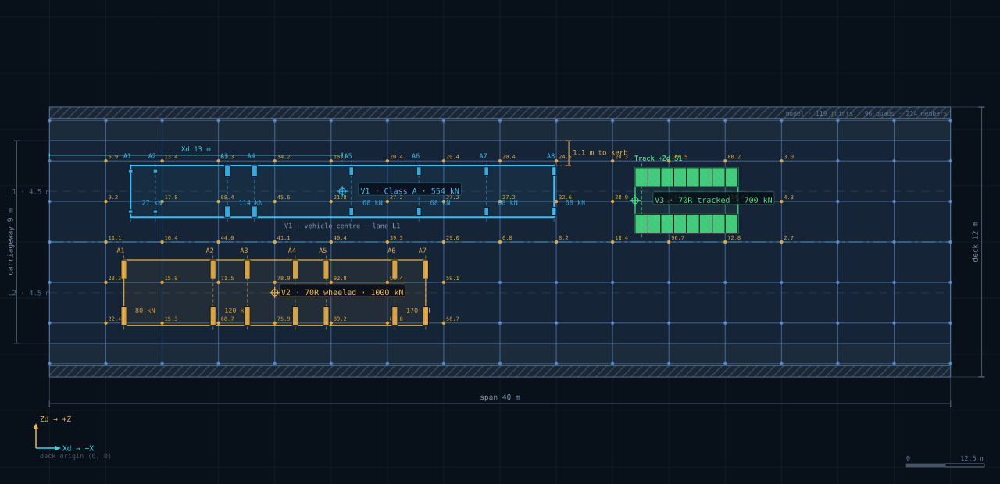

# STAAD.Pro IRC Live Load Studio

A bridge-engineering web application for defining deck geometry, positioning verified IRC highway
vehicles on a dimensionally scaled plan, generating STAAD.Pro input for the **moving-load** and
**explicit static-placement** workflows, and reconstructing a scene from pasted STAAD.Pro syntax.

Built with React 18, TypeScript, Vite, Tailwind CSS, SVG and Zustand. No backend: the whole model is
held client-side and persisted to browser storage or a JSON project file.



---

## 1. Quick start

```bash
npm install
npm run dev        # http://localhost:5173
npm run build      # type-check + production bundle in dist/
npm test           # 102 tests (1 additional developer utility is skipped by default)
```

Node 18+ is required. `npm run dev` binds to `0.0.0.0:5173`; the built `dist/` folder is a static site.

Regeneration utilities (developer-only test files):

```bash
WRITE_SAMPLES=1 npx vitest run tests/tools/write-samples.test.ts   # rewrite samples/
npx vitest run tests/tools/snapshot.test.tsx       # render artifacts/plan.svg + plan.png
```

---

## 2. What the application does

| Tab | Purpose |
|---|---|
| **Vehicle Placement** | Scaled SVG deck plan, drag/snap/exact-coordinate placement, live syntax panel, vehicle inspector |
| **Vehicle Library** | Four reference IRC presets plus editable/custom and imported definitions |
| **Syntax Import** | Paste STAAD.Pro text, inspect the parse report, reconstruct the scene |
| **Load Configuration** | Workflow choice, moving-load generation settings, static transfer method and case numbering |
| **Validation** | Geometry, placement, load, syntax and structural-model findings by severity and category |
| **Project Settings** | Target release, deck ↔ global coordinate mapping, structural model import, persistence, `.std` export |

Two deliberately separate workflows share one vehicle model:

* **Moving-load generation** emits `DEFINE MOVING LOAD` definitions followed by `LOAD GENERATION`
  sweeps. It is a *definition*, not a placement: the only position encoded is the sweep start.
* **Explicit static placement** emits one primary `LOAD` case per vehicle position, with joint forces
  produced by transferring every wheel/track load to the supplied structural model.

A moving-load definition is never presented as a specific vehicle position, and a graphical position
is never presented as a structurally valid load case.

---

## 3. Engineering conventions

Full detail in [docs/coordinate-system.md](docs/coordinate-system.md).

* **Units** — metres and kilonewtons internally, full float precision. Rounding happens only when
  values are written to screen or output text.
* **Deck axes** — `Xd` longitudinal from the start abutment (`0`) to the end abutment; `Zd`
  transverse, signed, `0` on the deck centreline and **+Zd towards the left deck edge**; `Yd` vertical,
  up, with the deck surface at `Yd = 0`.
* **Plan orientation** — screen *y* is `−Zd`, so the plan is never mirrored longitudinally and +Zd
  appears at the top.
* **Mapping** — one explicit transform from deck axes to STAAD global axes: axis assignment,
  per-axis sign, global origin and rotation about the vertical. Default `Xd→+X`, `Zd→+Z`, `Yd→+Y`,
  origin `(0,0,0)`, rotation `0°` — i.e. `FY = −P` downward.
* **Reference points** — a placement's coordinates refer to a named reference point
  (vehicle centre, datum/front, reference axle, or outer wheel edge). The reference point is shown on
  the canvas and in the generated comments; it is never silently assumed to be the vehicle centre.

---

## 4. Vehicle data and provenance

Verified values and their sources are documented in [docs/vehicle-data.md](docs/vehicle-data.md).
Summary:

| Preset | Total | Axles / tracks | IRC reference |
|---|---|---|---|
| Class A train | 554 kN | 8 axles, 27/27/114/114/68/68/68/68 kN, spacings 1.10/3.20/1.20/4.30/3.00/3.00/3.00 m, 1.80 m gauge | IRC:6-2017 Cl. 204.3, Fig. 2, Table 2 |
| Class 70R wheeled | 1000 kN | 7 axles, 80/120/120/170/170/170/170 kN, spacings 3.96/1.52/2.13/1.37/3.05/1.37 m | IRC:6-2017 Cl. 204.1, Fig. 1 |
| Class 70R tracked | 700 kN | 2 × 350 kN tracks, 4.57 m × 0.84 m contact, 2.06 m centres | IRC:6-2017 Cl. 204.1, Fig. 1 |
| Class 70R bogie | 400 kN | 2 × 200 kN axles at 1.22 m | IRC:6-2017 Cl. 204.1, Note 3 |

Data integrity measures:

* Loads and longitudinal spacings are the code values; ground-contact **patches** are separate fields
  and are documented per definition, including which of them are nominal.
* Editing any reference preset marks it `user-verified` and clears its verified flag, so a modified
  definition can never be mistaken for code data.
* `Restore preset` returns a definition to the reference values.
* Imported definitions are marked `imported` and carry only the geometry actually present in the
  source: `DEFINE MOVING LOAD` does not encode a transverse gauge, so an imported vehicle's gauge is
  reported as unknown rather than invented.

---

## 5. Moving-load workflow

```
DEFINE MOVING LOAD
TYPE 1 LOAD 27 27 114 114 68 68 68 68 DISTANCE 1.1 3.2 1.2 4.3 3 3 3 WIDTH 2.3
LOAD 100 LOADTYPE LIVE TITLE IRC MOVING LOAD V1
LOAD GENERATION 20
TYPE 1 3.6 0 2.25 XINC 1
```

* For `n` loads the generator always emits `n − 1` inter-load distances, and the parser rejects any
  other count.
* The generation start coordinates are the **first load of the definition**, computed through the
  active reference point and coordinate mapping. The app states this in the output comments.
* Representations:
  * `Axle loads + WIDTH` — the single-lane load-line idealisation (default for wheeled vehicles).
  * `Explicit wheel lines` — one definition per wheel line (half-axle loads, gauge in the transverse
    position). Emitted automatically for tracked vehicles, which a single `WIDTH` cannot represent.
  * `Axle loads, no WIDTH` — for grammars that reject `WIDTH`.
* Type numbers are allocated per placement and validated for uniqueness.
* Generation is **blocked** when the deck mapping is rotated: `XINC/ZINC` can only sweep one global
  axis, and pretending otherwise would emit a sweep that differs from the plan.
* Impact/dynamic multipliers are user assumptions only; the app never derives IRC impact factors.

---

## 6. Explicit static-placement workflow

A static case is emitted only when **every** wheel or track slice can be transferred to the supplied
structural model. Otherwise the case is rejected and the reason is printed into the document as a
comment, never as a partial vehicle.

```
LOAD 301 LOADTYPE LIVE TITLE CLASS A V1 POS
JOINT LOAD
11 FY -2.295
12 FY -9.18
...
```

Supported transfer methods (`Load Configuration` → transfer method):

| Method | Requirement | Behaviour |
|---|---|---|
| Exact joint only | joints | load accepted only inside the joint tolerance; otherwise an error and no load |
| Nearest joint | joints | snaps to the closest joint and reports every snap distance |
| Two-joint lever | `MEMBER INCIDENCES` | load must lie on a member axis; split by linear interpolation along it |
| Four-joint bilinear | `ELEMENT INCIDENCES SHELL` | load must lie inside a quad; split by bilinear shape functions |

Model import reads `JOINT COORDINATES`, `MEMBER INCIDENCES` and `ELEMENT INCIDENCES SHELL` only.
The applied-versus-emitted load is reconciled for every case and reported.

---

## 7. Syntax import and reconstruction

The parser is line-oriented and never drops text.

1. Tokenise, preserving 1-based line numbers.
2. Recognise `DEFINE MOVING LOAD`, `LOAD GENERATION`, `LOAD … LOADTYPE … TITLE` + `JOINT LOAD`,
   `UNIT`, and the structural model commands.
3. Match each definition to the library by load magnitudes and spacings; unmatched definitions become
   imported vehicles with unknown transverse geometry.
4. Reconstruct placements **only** from positions present in the source (a `LOAD GENERATION` start
   point). A definition alone produces no placement.
5. Preserve unsupported lines verbatim with a reason and line number; report a partial import.
6. Refuse to apply a source with blocking parse errors.

Draft editing is separate from generation: manual edits are kept, parsed live, marked out of sync with
the scene, and only replace the scene when explicitly applied.

---

## 8. Validation

`Validation` aggregates findings from geometry, placements, loads, syntax and the structural model:

* component widths against total deck width; derived versus entered carriageway; lane continuity;
* barrier interference, off-deck and off-carriageway positions (reported, never silently corrected);
* IRC:6-2017 kerb clearances — 1.20 m for Class 70R (Cl. 204.1 note 4), 0.15 m for Class A
  (Table 3);
* edge-clearance reproduction to 0.1 mm after any geometry edit;
* wheel-load sums against axle loads, zero or negative loads, applied-versus-emitted totals;
* load/distance counts, required parameters, unique type and case numbers;
* a **self-check**: the generated document is re-parsed and any error is surfaced as a generator bug.

A clean list means the application could not find an inconsistency in what it can check. It is not a
claim of code compliance or structural adequacy.

---

## 9. Persistence and export

* `Save` (Ctrl+S) writes the project to `localStorage`; it is restored on the next visit.
* `Export JSON` / `Import JSON` use the versioned `ProjectFile` schema (geometry, vehicle definitions,
  placements, structural model, moving settings, coordinate mapping).
* `Export .std` writes the same deterministic text shown in the syntax panel.
* Undo/redo (Ctrl+Z, Ctrl+Shift+Z) covers geometry, placements, library and settings changes.

Output is deterministic: identical inputs produce byte-identical syntax (no timestamps, no random ids,
locale-independent number formatting).

---

## 10. Testing

```
npm test
```

| Suite | Coverage |
|---|---|
| `tests/geometry.test.ts` (26) | lane derivation, reference points, IRC load data, wheel-load splitting, edge-clearance solving, footprints, transforms and mapping round trips |
| `tests/syntax.test.ts` (43) | moving-load plans, generation start, rotation blocking, determinism, parser robustness, transfer methods, static case emission/rejection, reconstruction |
| `tests/project-schema.test.ts` (12) | project-file schema: JSON failures, field paths, cross-field checks, version gate |
| `tests/app.test.tsx` (20) | tab rendering, canvas rendering, model → syntax integration, undo/redo, library provenance, persistence, import flow, syntax editor |

The PRD's release gates require real STAAD.Pro execution tests and independent engineering
verification. **Those have not been run** — see [docs/limitations.md](docs/limitations.md).

---

## 11. Repository layout

```
src/
  lib/
    geometry.ts        deck layout, placements, footprints, clearances
    coords.ts          deck ↔ STAAD global mapping
    vehicles.ts        IRC reference library + validation
    validation.ts      cross-cutting diagnostics
    project.ts         defaults, sample project, JSON format
    syntax/
      adapters.ts      version-aware adapters (2022 / 2025)
      moving.ts        moving-load definition + generation engine
      static.ts        explicit static load-case engine
      transfer.ts      wheel/track load transfer to joints
      model.ts         structural model text import
      parse.ts         parser for supported syntax
      import.ts        scene reconstruction
      document.ts      full deterministic document assembly
  components/          canvas, editor, panels, shell
  store/studio.ts      typed store, history, persistence
tests/                 unit, integration and developer tools
samples/               generated sample .std files and a JSON project
docs/                  engineering documentation
```

---

## 12. Scope and disclaimer

This tool prepares input for review; it does not replace the structural solver, code compliance checks,
critical-position search, or independent verification. Generated files are syntax-checked by the
application's own parser and have **not** been executed in a licensed STAAD.Pro installation as part
of this build. Verify every file in the target release before design use.

IRC is a registered organisation; this project is not affiliated with or endorsed by it.
